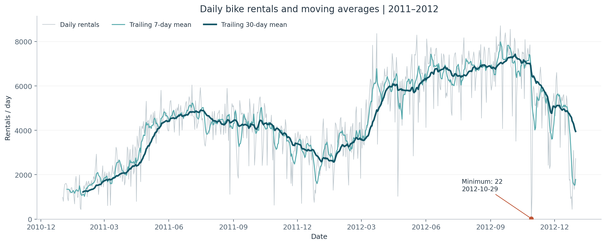
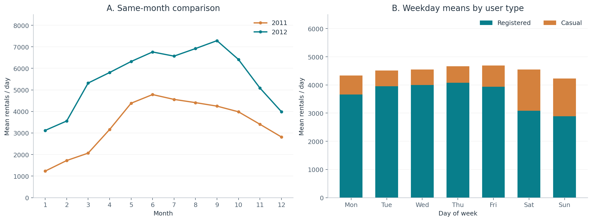
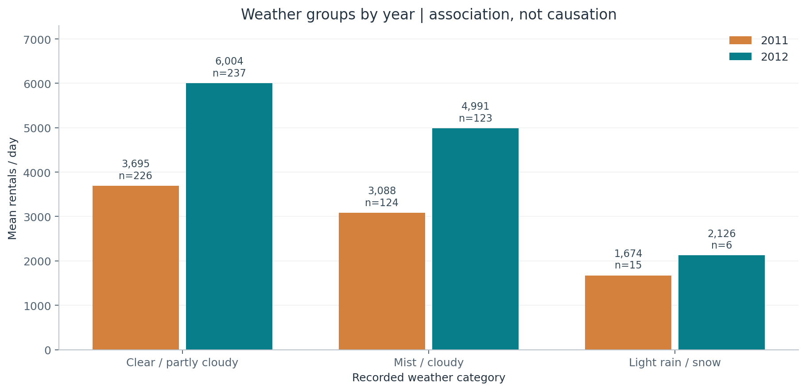

# 공유자전거 이용량은 언제, 어떻게 달라질까?

Capital Bikeshare의 2011~2012년 일별 대여 기록을 분석한 시계열 인사이트 리포트다. **2012년 일평균 대여량은 전년보다 64.4% 높았고, 주말에는 전체 이용량보다 이용자 구성의 변화가 두드러졌다.** 날씨가 좋지 않은 범주의 이용량도 낮았지만, 그 차이를 날씨만의 인과 효과로 해석하지는 않는다.

## 1. 분석 주제 및 선정 이유

공유자전거 이용량은 계절·요일·날씨 등 일상적으로 이해하기 쉬운 조건에 따라 변화를 살펴볼 수 있는 시계열 데이터다. 일별 이용량에서 장기적인 추세와 반복되는 패턴을 발견하고, 이용량이 높거나 낮은 시기의 특징을 해석하고자 선정했다. 또한 2년간의 일별 데이터 731개가 제공되어 이동평균과 월별·요일별 비교를 적용하기에 적합하다고 판단했다.

분석 대상 지표는 **하루 총 대여 건수(`cnt`)**다. 같은 사람이 여러 번 대여할 수 있으므로 고유 이용자 수와 구분한다. 이용자 유형과 날씨 컬럼은 이 시계열의 변화를 해석하는 데 활용한다.

## 2. 분석 질문

1. 2012년 이용량은 2011년보다 늘었는가? 같은 달끼리 비교해도 증가가 나타나는가?
2. 월별·요일별 반복 패턴이 보이는가? 평일과 주말에 일반 이용자와 등록 이용자의 이용 방식은 어떻게 다른가?
3. 날씨 범주에 따라 일평균 이용량은 얼마나 다른가? 연도를 나누어도 같은 방향의 차이가 나타나는가?
4. 전체 분포에서는 평범해 보이더라도, 최근 흐름에 비해 급격히 달라진 날이 있는가?

## 3. 데이터 설명

| 항목 | 내용 |
|---|---|
| 데이터셋 | UCI Machine Learning Repository — Bike Sharing |
| 원자료 대상 | 미국 워싱턴 D.C. Capital Bikeshare 대여 기록 |
| 분석 파일 | [`data/raw/day.csv`](data/raw/day.csv) |
| 기간 | 2011-01-01 ~ 2012-12-31 |
| 단위·규모 | 하루 1행, 731행, 원본 16개 컬럼 |
| 날짜 기준 | 제공된 일별 집계 날짜를 그대로 사용하며 한국 시간으로 변환하지 않음 |
| 출처 | [UCI 데이터셋 페이지](https://archive.ics.uci.edu/dataset/275/bike+sharing+dataset), [데이터셋 DOI](https://doi.org/10.24432/C5W894) |
| 수집 방법 | 공개 ZIP에서 `day.csv`와 `Readme.txt`를 추출; API 키·로그인 불필요 |

주요 컬럼은 다음과 같다. 원본의 모든 컬럼을 보존하고 분석용 컬럼을 별도로 추가했다.

| 컬럼 | 의미 및 사용 방법 |
|---|---|
| `dteday` | 집계 날짜. 날짜형으로 변환하고 오름차순 정렬 |
| `cnt` | 총 대여 건수. 분석의 중심 시계열 |
| `casual`, `registered` | 각각 일반 이용자와 등록 이용자의 대여 건수. 합계가 `cnt`와 일치하는지 검증 |
| `yr`, `mnth`, `weekday` | 연도·월·요일 코드. 실제 날짜에서 계산한 값과 대조. 원본 요일은 0=일요일 |
| `holiday`, `workingday` | 현지 휴일 여부, 주말·휴일을 제외한 근무일 여부 |
| `weathersit` | 날씨 범주. 아래 정의를 사용 |
| `temp`, `atemp`, `hum`, `windspeed` | 정규화된 기온·체감기온·습도·풍속. 범위 검사에 사용하며 원 단위로 환산하지 않음 |
| `season`, `instant` | 계절 코드와 행 식별자. 원본에 보존하며 계절 코드를 이용한 집계는 하지 않음 |

날씨 코드는 1=맑음·일부 구름, 2=안개·흐림, 3=약한 비·눈 등을 포함한 범주, 4=강한 비·눈 등이다. 이번 일별 파일에는 **1~3번만 존재**한다. 4번 범주의 데이터가 없다는 사실을 해당 날씨에 대여가 0건이었다는 의미로 해석하지 않는다. 원본 설명은 [`Readme.txt`](data/raw/Readme.txt)에 보존했다.

### 기본 통계

| 지표 | 결과 |
|---|---:|
| 전체 대여 건수 | 3,292,679건 |
| 일평균 | 4,504.3건 |
| 일별 중앙값 | 4,548건 |
| 최솟값 | 22건 — 2012-10-29 |
| 최댓값 | 8,714건 — 2012-09-15 |

## 4. 데이터 정제 및 검증 기준

원본 파일의 SHA-256을 고정해 분석 입력이 바뀌지 않았는지 확인했다. 날짜를 변환하고 정렬한 뒤 아래 검사를 수행했으며, **삭제·보간·값 수정 없이 731행을 모두 분석에 사용했다.**

| 검사 | 기준 | 결과 및 처리 |
|---|---|---|
| 결측치 | 원본 16개 컬럼의 빈 값 검사 | 0개. 보간하지 않음 |
| 중복 | 완전히 같은 행 및 같은 날짜 중복 검사 | 각각 0개. 삭제하지 않음 |
| 날짜 누락 | 분석 기간의 매일이 존재하는지 확인 | 누락 0일. 2012년 윤일 포함 |
| 건수 유효성 | 대여 건수가 유한한 0 이상의 정수인지 확인 | 위반 0개 |
| 합계 일치 | `casual + registered == cnt` | 731행 모두 일치 |
| 날짜·범주 일치 | 연도·월·요일·근무일 코드와 실제 날짜 대조 | 위반 0개 |
| 정규화 변수 | 기온·체감기온·습도·풍속이 0~1 범위인지 확인 | 위반 0개 |
| 전체 분포의 이상치 후보 | `Q1 − 1.5×IQR` 미만 또는 `Q3 + 1.5×IQR` 초과 | 경계 −1,054~10,162건, 후보 0일 |
| 최근 흐름의 이상치 후보 | 당일 제외 직전 30일 평균·표본 표준편차 기준 `|z| > 3` | 후보 14일. 오류로 단정하거나 제거하지 않음 |

결측치는 있어야 할 값이 비어 있는 상태이고, 이상치는 기준에 비해 유난히 크거나 작은 관측값이다. **이상치 후보가 곧 잘못된 데이터는 아니다.** 낮은 이용량이 실제 운영 상황을 반영할 수 있으므로, 날짜 중복·음수·합계 불일치 같은 오류 근거가 없다면 보존한다. 검증에 실패한 입력은 자동으로 고치지 않고 분석을 중단해 검토하도록 했다.

이동평균을 계산하기 전 필요한 기간이 쌓이지 않은 앞부분은 파생 지표의 결측치로 남긴다. 7일 평균은 첫 6일, 30일 평균은 첫 29일, 전일 변화율은 첫 1일, 직전 30일 기반 통계는 첫 30일이 해당한다. 원본 결측치와 구분하며 0으로 채우지 않는다.

## 5. 적용한 시계열 분석 기법

| 기법 | 계산 방법 | 적용 이유 |
|---|---|---|
| 7일·30일 이동평균 | 당일을 포함한 최근 7일·30일의 단순평균. 전체 창이 있어야 계산 | 단기 흔들림을 줄여 각각 주간·월간 수준의 흐름 확인 |
| 전일 대비 변화율 | `(당일 건수 / 전일 건수 − 1) × 100` | 급격한 변화 날짜 확인. 이번 데이터의 전일 건수는 모두 양수 |
| 연도별·월별 통계 | 연도별 합계·일평균, 연도×월별 일평균, 같은 달의 전년 대비 변화율 | 기간별 규모와 반복 패턴 비교 |
| 요일·이용자 유형별 집계 | 각 요일 및 평일·주말의 유형별 일평균 | 전체 건수에 가려진 이용자 구성 차이 파악 |
| 날씨별 집계 | 연도×날씨 범주의 평균과 표본 일수 | 연도별 수준 차이와 범주별 표본 불균형을 함께 확인 |
| 직전 30일 대비 편차 | `z = (당일 건수 − 직전 30일 평균) / 직전 30일 표본 표준편차` | 전체 IQR로 놓치는 최근 흐름의 급변 후보 확인 |

월별 비교에는 **월 합계 대신 일평균**을 사용했다. 월별 일수 차이와 2012년 윤년의 영향을 줄이기 위해서다. 이동평균은 뒤쪽으로 계산하므로 변화에 늦게 반응할 수 있다. 최근 편차는 현재 관측값을 기준 계산에서 제외했으며, 정규분포를 가정한 유의성 검정이나 확정적인 이상 판정으로 사용하지 않았다.

여기서 **추세**는 연도 간 이용 수준의 변화, **계절성**은 월·요일에 따라 반복될 가능성이 있는 패턴, **노이즈**는 그 위에 겹치는 일별 불규칙 변동을 뜻한다. 노이즈에는 데이터 오류뿐 아니라 관측하지 않은 사건도 섞일 수 있다. 2년만으로 장기 계절성을 확정할 수는 없다.

## 6. 시각화 및 분석 결과

그래프의 단위는 대여 건수이며 세로축은 0에서 시작한다. 원본 날짜를 정렬한 일 단위 시계열과 달력별 집계를 함께 사용했다. 실행 환경에 따른 한글 폰트 문제를 피하기 위해 그림의 축·범례는 영문으로 표기했다.

### 그림 1. 일별 이용량과 이동평균



회색은 실제 일별 건수, 옅은 청록색은 7일 이동평균, 진한 청록색은 30일 이동평균이다. 2012년에는 전반적으로 높은 수준이 나타나지만 두 해 모두 연말로 갈수록 낮아지는 구간이 보인다. 2012-10-29의 22건처럼 원자료의 급락이 이동평균에서는 완화되므로 두 선을 함께 읽어야 한다.

### 그림 2. 같은 달 비교 및 요일별 이용자 구성



왼쪽은 각 달의 하루 평균 대여 건수다. **12개월 모두 2012년이 2011년보다 높다.** 2011년 최고 월평균은 6월 4,783.7건, 2012년은 9월 7,285.8건이며, 두 해 모두 1월이 가장 낮다. 따라서 반복적인 겨울 저수요의 징후와 함께, 해마다 정점이 다를 수 있다는 점도 보인다.

오른쪽은 2년을 합친 요일별 평균을 일반 이용자(Casual)와 등록 이용자(Registered)로 나누어 쌓은 막대다. 주말에는 일반 이용자의 비중이 커진다. 정확한 평일·주말 비교에는 아래 7.2절의 일수 가중 평균을 사용하며, 월~금 막대 5개의 단순평균을 쓰지 않았다.

### 그림 3. 연도별 날씨 범주와 이용량



주황색은 2011년, 청록색은 2012년이다. 막대 위 숫자는 일평균 건수, `n`은 해당 범주의 관측 일수다. 두 해 모두 범주 1, 2, 3 순서로 평균이 낮아진다. 다만 2012년 범주 3은 6일뿐이므로, 막대의 높이와 함께 표본 크기를 확인해야 한다.

## 7. 인사이트: 관찰·해석·활용

### 7.1 2012년에 더 많이 빌렸지만, 연말에는 이용이 줄었다

**관찰 — 그림 1·2, [`annual.csv`](data/processed/annual.csv), [`monthly.csv`](data/processed/monthly.csv)**


**그림에서 볼 곳:** 왼쪽 그래프의 주황색은 2011년, 청록색은 2012년이다. 같은 달의 두 점을 비교하면 청록색이 항상 위에 있다. 두 선 모두 연말로 갈수록 내려간다.

| 연도 | 관측 일수 | 연간 총 대여 | 일평균 대여 |
|---|---:|---:|---:|
| 2011 | 365일 | 1,243,103건 | 3,405.8건 |
| 2012 | 366일 | 2,049,576건 | 5,599.9건 |

연간 합계는 **64.9%**, 일평균은 **64.4%** 증가했다. 같은 달을 비교해도 12개월 모두 증가했다. 한편 2012년 일평균은 9월 7,285.8건에서 12월 3,990.7건으로 낮아졌다. 2012년에 전체적으로 더 많이 빌렸어도, 연말로 갈수록 이용이 줄어드는 모습은 나타났다.

**해석(가설)** — 2012년에는 이 서비스를 알게 된 사람이 늘었거나, 자전거와 대여소가 늘어 빌리기 편해졌을 수 있다. 연말에 이용이 줄어든 것은 겨울이 되면서 추워지고 해가 짧아져 자전거를 덜 타기 때문일 수 있다.

**활용 제안** — 앞으로 얼마나 이용할지 가늠할 때는 작년 평균 하나만 보기보다 최근 이용량과 작년 같은 달의 이용량을 함께 보는 편이 좋다.

### 7.2 주말에는 일반 이용자의 대여가 늘고, 등록 이용자의 대여는 줄었다

**관찰 — 그림 2 오른쪽, [`day_type.csv`](data/processed/day_type.csv)**


**그림에서 볼 곳:** 오른쪽 그래프에서 주황색은 일반 이용자, 청록색은 등록 이용자의 대여다. 토·일(`Sat`, `Sun`)에는 주황색 부분이 커지고 청록색 부분이 작아진다. 막대 전체 높이보다 각 색의 높이 변화를 보면 차이가 잘 보인다.

| 구분 | 일수 | 총 대여 일평균 | 일반 이용자 일평균 | 등록 이용자 일평균 |
|---|---:|---:|---:|---:|
| 평일(월~금) | 521일 | 4,550.6건 | 625.0건 | 3,925.5건 |
| 주말(토·일) | 210일 | 4,389.7건 | 1,401.8건 | 2,987.9건 |

주말의 일반 이용자 대여는 평일의 **2.24배**, 등록 이용자 대여는 평일보다 **23.9% 낮다.** 한쪽은 늘고 다른 쪽은 줄어, 둘을 합친 총 대여량은 주말에 **3.5% 적은 정도**였다. 이 절의 평일에는 평일에 해당하는 현지 공휴일도 포함하며, 원본 `workingday=1`과 구분한다.

**해석(가설)** — 등록 이용자 중에는 출퇴근처럼 평일에 자주 타려고 가입한 사람이 많을 수 있다. 그렇다면 출근하지 않는 주말에는 덜 빌릴 것이다. 반대로 일반 이용자는 주말에 나들이하거나 여행하면서 필요할 때 빌리는 경우가 많아 대여가 늘었을 수 있다.

**활용 제안** — 이 설명이 맞는지 알아보려면 평일에는 출퇴근 시간대에, 주말에는 낮 시간대나 관광지 근처에서 많이 빌리는지 추가로 확인하면 좋다.

### 7.3 약한 비·눈 등이 포함된 날씨에는 대여가 적었다

**관찰 — 그림 3, [`weather.csv`](data/processed/weather.csv)**


**그림에서 볼 곳:** 왼쪽부터 맑음·일부 구름, 안개·흐림, 약한 비·눈 등이다. 같은 색끼리 보면 오른쪽으로 갈수록 막대가 낮아진다. 막대 위 `n`은 기록한 날짜 수로, `n=6`이면 6일의 평균이라는 뜻이다.

| 날씨 범주 | 2011년 일평균(일수) | 2012년 일평균(일수) |
|---|---:|---:|
| 1: 맑음·일부 구름 | 3,695.0건 (226일) | 6,003.7건 (237일) |
| 2: 안개·흐림 | 3,088.1건 (124일) | 4,991.3건 (123일) |
| 3: 약한 비·눈 등 | 1,674.1건 (15일) | 2,126.2건 (6일) |

범주 3의 평균은 범주 1보다 2011년에 **54.7%**, 2012년에 **64.6%** 낮다. 연도를 나누어도 차이의 방향은 같지만, 범주 3의 전체 표본은 **21일**이며 두 해의 관측 일수도 다르다.

**해석(가설)** — 비나 눈이 오면 옷이 젖거나 길이 미끄러워 자전거 타기를 꺼릴 수 있다. 그래서 걷거나 다른 교통수단을 이용하거나, 외출 자체를 줄였을 가능성이 있다.

**활용 제안** — 날씨 때문에 얼마나 달라지는지 더 알아보려면 같은 달, 비슷한 기온인 날끼리 비교하고 비·눈이 온 날의 기록도 더 모아야 한다.

### 7.4 갑자기 줄어든 날은 최근 한 달과 비교하면 잘 보인다

**관찰 — 그림 1, [`flagged_days.csv`](data/processed/flagged_days.csv)**


**그림에서 볼 곳:** 오른쪽 아래 `Minimum: 22`로 표시한 점이 2012년 10월 29일이다. 회색 선은 실제 하루 대여량, 진한 청록색 선은 최근 30일 평균이다. 표시된 날의 앞뒤를 숫자로 보면 급락이 더 뚜렷하다.

| 날짜 | 하루 대여량 |
|---|---:|
| 2012-10-28 | 4,459건 |
| **2012-10-29** | **22건** |
| 2012-10-30 | 1,096건 |

2년 전체를 한꺼번에 비교한 IQR 기준에서는 이상치 후보가 **0일**이었다. 반면 직전 30일의 평소 수준과 비교한 기준(`|z| > 3`)에서는 **14일**이 후보로 나타났다. 최저일인 **2012-10-29는 22건**으로, 전날 4,459건보다 **99.5% 감소**했고 직전 30일 평균 6,920.0건 대비 `z = −5.85`였다.

다음 날은 1,096건으로 전일 대비 **4,881.8% 증가**했지만, 직전 30일 평균 6,635.6건보다 여전히 훨씬 낮았다. 전날이 단 22건이어서 증가율이 크게 나온 것이다. 증가율만 보고 평소 수준으로 돌아왔다고 말할 수는 없다.

**해석(가설)** — 평소 수천 건씩 빌리다가 하루 22건만 기록됐다면, 그날 자전거를 빌릴 수 없었거나 날씨가 크게 나빴거나 기록이 일부 빠졌을 수 있다. 2년 전체에는 원래 적게 빌리는 시기와 많이 빌리는 시기가 섞여 있어 이런 급락이 잘 드러나지 않을 수 있다. 최근 한 달과 비교하면 평소와 얼마나 달랐는지 더 쉽게 보인다.

**활용 제안** — 크게 달라진 14일은 지우지 않고 따로 살펴본다. 당시 운영 공지나 원래 대여 기록을 찾아보면 실제로 이용이 줄었는지, 기록에 문제가 있었는지 확인하는 데 도움이 된다.

## 8. 결론 및 한계점

731일의 자료에서 연도 간 이용 규모 증가와 겨울철 저수요의 징후를 확인했다. 요일별 총량만 보면 작아 보이는 차이도 이용자 유형을 나누면 크게 드러났으며, 날씨 범주와 이용량 사이에도 일관된 방향의 차이가 있었다. 급격한 변화를 해석할 때에는 전체 분포의 기준보다 최근 흐름과의 비교가 추가 정보를 제공했다.

다만 다음 한계가 있다.

- **기간·지역의 한계:** 2011~2012년 워싱턴 D.C.의 과거 자료다. 현재 서비스나 국내 공유자전거에 결과를 그대로 적용할 수 없다. 연간 반복은 2회뿐이므로 장기 계절성도 확정하지 않는다.
- **수요와 공급의 혼재:** 대여 건수는 실제 이용 실적이다. 대여소·자전거 부족이나 운영 중단으로 충족되지 않은 수요는 드러나지 않는다.
- **교란 요인:** 요일·날씨 비교는 기술통계다. 기온·계절·공급량 등 여러 요인을 동시에 통제하지 않아 원인으로 단정할 수 없다.
- **표본 불균형:** 날씨 범주 3은 21일뿐이고 범주 4는 없다. 날씨별 평균 차이의 불확실성을 신뢰구간이나 유의성 검정으로 평가하지 않았다.
- **일 단위 집계:** 출퇴근 시간대와 대여소별 수급 차이가 가려진다. 일반/등록 이용자 구분으로 이용 목적을 확정할 수 없다.
- **탐색 기준의 한계:** 30일 창과 3표준편차는 검토를 위한 기준이다. 다른 창·기준을 적용하면 후보 날짜가 달라질 수 있다.

## 9. AI 사용 로그

AI 도구는 **OpenAI Codex**를 사용했다. 아래 검증은 이 작업에서 AI가 도구로 수행한 내용이며, 사용자가 직접 검증했다고 주장하는 기록이 아니다. 해석은 관찰 수치와 구분한 가설로 작성했다.

| 사용 작업 및 요청 요지 | 사용 이유 | 수행한 검증 방법 |
|---|---|---|
| “100개 이상이며 분석 질문을 만들기 쉬운 시계열 데이터 후보를 비교해줘.” | 수집 난이도와 분석 가능성을 함께 검토 | UCI 공식 설명·원본 ZIP·라이선스 확인, 일별 파일의 기간·731행 직접 확인 |
| “원본을 보존하면서 결측·중복·날짜·건수 일관성을 검사해줘.” | 전처리 누락 방지 및 재현성 확보 | 원본 해시 고정, 날짜 연속성·합계 일치·범주 검사, 오류 시 실행 중단 |
| “이동평균·집계·변화율로 질문에 답하고 그림을 만들어줘.” | 반복 계산 자동화와 비교 방식 탐색 | 스크립트 실제 실행, 별도 표준 라이브러리 검증 스크립트로 원본 재계산, PNG 3개 시각 확인 |
| “관찰과 원인 가설을 분리하고 한계를 적어줘.” | 수치에서 원인으로 비약하는 서술 점검 | 본문 수치와 CSV·JSON 대조, 표본 일수 명시, 미확인 원인을 가설로 표시 |

검증 사례로 연간 합계의 증가율(64.9%)과 일평균의 증가율(64.4%)을 구분했고, 전일 대비 4,881.8% 증가한 날에도 절대 건수는 낮다는 점을 함께 확인했다. 사용자는 제출 전에 질문별 근거와 가설의 한계를 검토하고 본인의 말로 설명할 수 있어야 한다.

## 10. 실행 및 재현 방법

Python 3.10 이상을 사용한다. 이 결과는 macOS, Python 3.13.7, NumPy 2.2.6, pandas 2.3.3, Matplotlib 3.10.7에서 실행·검증했다. 직접 사용하는 라이브러리 버전은 [`requirements.txt`](requirements.txt)에 고정했다.

저장소 루트에서 실행한다.

```bash
python3 -m venv .venv
source .venv/bin/activate
python -m pip install -r requirements.txt
python analysis.py
python scripts/verify_results.py
```

Windows에서는 가상환경 활성화 명령을 `.venv\Scripts\activate`로 바꾼다. 저장소에 원본을 포함하므로 분석 실행에는 네트워크 연결이나 API 키가 필요 없다.

원본을 다시 수집하려면 다음 명령을 별도로 실행한다. 기존 원본 파일을 동일한 공개 데이터로 교체하며, 고정한 체크섬과 다르면 저장하지 않는다.

```bash
python scripts/download_data.py
```

`analysis.py`는 `images/`의 그림 3개와 `data/processed/`의 CSV 9개·`summary.json`을 다시 생성한다. 검증 스크립트는 원본에서 독립적으로 합계·집계·표본 이동평균·변화율을 계산해 결과와 대조하고, 보고서의 핵심 수치와 로컬 링크를 확인한다. **README 본문은 자동 생성하지 않으므로 분석 방법이나 데이터를 변경하면 본문도 함께 갱신해야 한다.** 원본을 변경하려면 체크섬·스키마·검증 조건도 먼저 검토해야 한다.

### 파일 구성

```text
.
├── README.md                     # 분석 보고서 및 실행 방법
├── analysis.py                   # 정제·분석·집계·시각화
├── requirements.txt              # 직접 의존성 버전
├── scripts/
│   ├── download_data.py          # 공식 데이터 수집 및 체크섬 확인
│   └── verify_results.py         # 원본과 결과의 독립 재계산·대조
├── data/
│   ├── source.json               # 출처·라이선스·파일 SHA-256
│   ├── raw/
│   │   ├── day.csv               # 수정하지 않은 UCI 일별 원본
│   │   └── Readme.txt            # 원본 설명 및 인용 정보
│   └── processed/                # 분석용 일별 데이터·집계표·검증 결과
└── images/
    ├── 01_rental_trend.png
    ├── 02_calendar_patterns.png
    └── 03_weather_patterns.png
```

분석용 일별 데이터에는 원본 컬럼과 날짜·달력·이동평균·변화율·이상치 후보 컬럼이 포함된다. [`summary.json`](data/processed/summary.json)에는 기본 통계와 검증 결과, [`month_comparison.csv`](data/processed/month_comparison.csv)에는 같은 달의 전년 대비 변화율을 저장했다. 원본 일별 행 수와 값은 보존했다.

## 11. 출처·수집 방법·라이선스

데이터 인용: Fanaee-T, H. (2013). *Bike Sharing* [Dataset]. UCI Machine Learning Repository. [https://doi.org/10.24432/C5W894](https://doi.org/10.24432/C5W894).

원본 설명에 제시된 관련 논문: Fanaee-T, H., & Gama, J. (2013). *Event labeling combining ensemble detectors and background knowledge*. Progress in Artificial Intelligence. [https://doi.org/10.1007/s13748-013-0040-3](https://doi.org/10.1007/s13748-013-0040-3).

UCI 데이터셋 페이지에 명시된 라이선스는 [CC BY 4.0](https://creativecommons.org/licenses/by/4.0/)이다. 재사용 시 원저작자·출처와 라이선스를 표시하고 변경 내용을 밝혀야 한다. 이 저장소는 원본 `day.csv`와 설명 파일을 그대로 보존하고, 분석용 파생 컬럼·집계표·그림을 추가했다. 원저작자가 본 분석을 검증하거나 보증한 것은 아니다. 데이터 라이선스를 별도로 작성한 코드 전체의 라이선스로 확대 해석하지 않는다.

수집 URL과 원본 체크섬은 [`data/source.json`](data/source.json)에 기록했다. 현재 보고서의 수치는 해당 고정 원본을 기준으로 한다.
